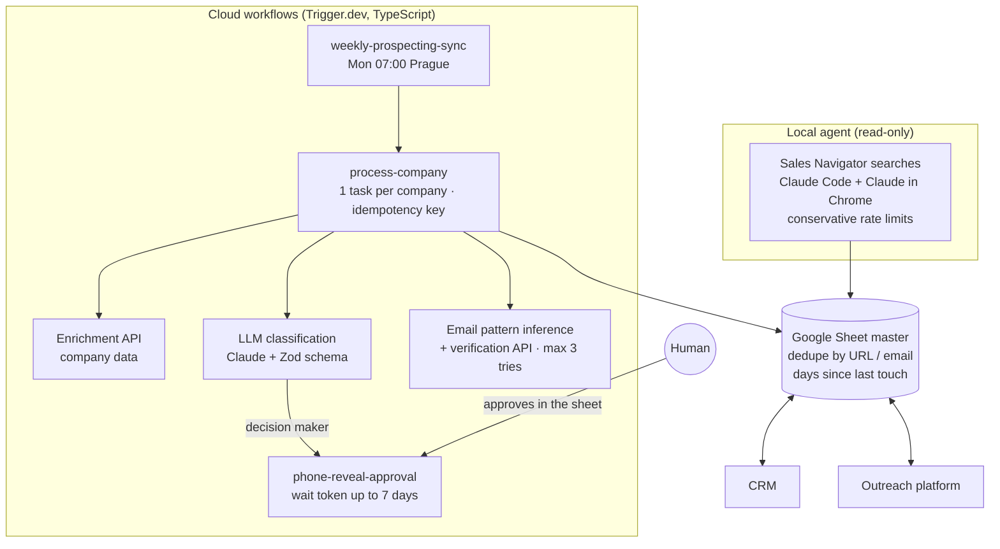

# Architecture

**Why hybrid?** The browser part needs a logged-in session, so it runs locally and only reads. Everything that calls APIs, costs money or must run on a schedule lives in the cloud, with retries and logs.
